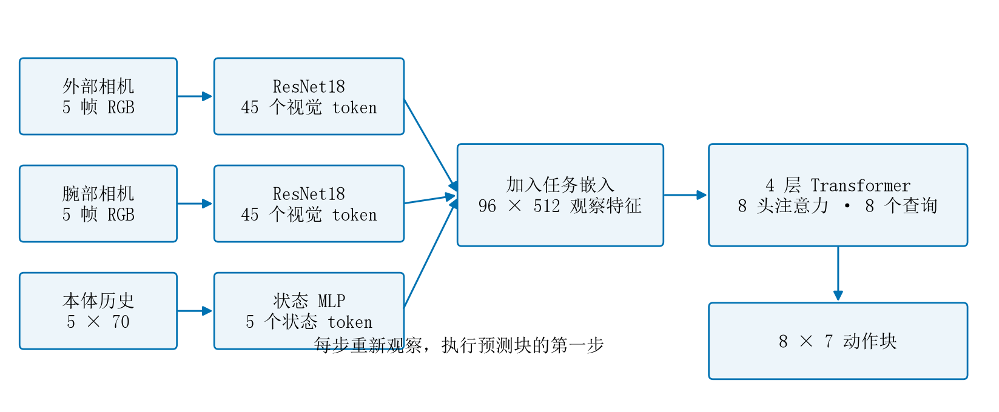
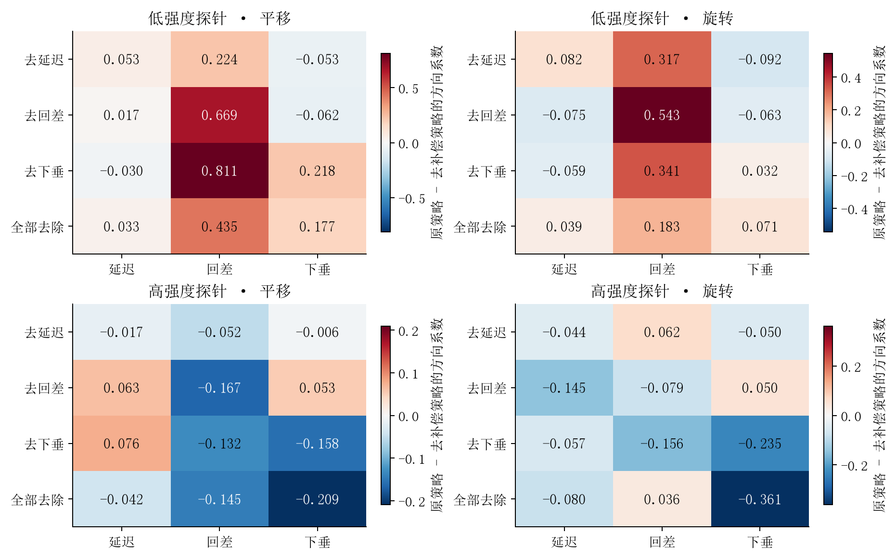

# Demonstration Compensation Leakage in Cross-Embodiment Imitation Learning

跨本体模仿学习中的示教补偿泄漏研究

不同执行条件的机械臂完成同一任务时，示教动作会包含适应自身延迟、回差或下垂的调整。本项目研究这些补偿如何通过合并后的动作标签进入共享策略，以及策略在不同目标身体上的表现。

实验采用相同形态的 Panda 机械臂，以正常执行作为参考，在 MuJoCo / robosuite 中分别引入控制延迟、第三关节回差和重力补偿欠量。共享策略融合双视角 RGB 与本体历史，通过 ResNet-18 编码器和 Transformer 动作解码器预测动作块。

## 实验

- **补偿测量**：在同一状态和参考时刻查询来源教师与正常教师，以两者动作差定义补偿方向。
- **池化学习**：比较正常与三类来源的均衡混合、来源比例变化和两档物理强度。
- **标签干预**：固定观察与训练设置，分别去除延迟、回差、下垂或全部来源补偿，比较对应预测分量。
- **目标交叉执行**：在正常及三类缺陷目标上运行策略，记录轨迹、接触、物体高度和终末结果。

共收集 **588 条示教**，完成 **11 种条件 × 3 次重复，共 33 个策略**；分析包括 **33 项单模型测量、15 对标签干预和 5,544 条自主执行轨迹**。



## 结果

补偿标签改变了共享策略的方向性输出。下垂在标签干预、来源比例和强度比较中表现较连贯；回差干预在三次训练中同向，但绝对命令分量较小；延迟的选择性标签效应在训练重复之间存在方向差异。

标签变化也影响了执行路径、物体高度与接触过程。5,544 条轨迹中有 2 条达到终末堆叠成功。当前证据能说明补偿标签影响了策略输出和操作过程，尚不能把普遍任务失败归因于补偿失配。



## 材料

- [研究报告](docs/report.pdf)
- [汇报幻灯片](docs/presentation.pdf)
- [可编辑幻灯片](https://github.com/ai4sci-z/embodied-compensation-leakage/releases/tag/v1.0)
- [配对轨迹视频与关键帧](media/)
- [视频展示页](media/index.html)
- [训练、评估与绘图代码](code/)
- [逐模型与逐轨迹结果](code/results/)
- [模型权重](https://github.com/ai4sci-z/embodied-compensation-leakage/releases/tag/v1.0)

33 个最终权重在 Release 中提供，避免将大文件放入 Git 历史。原始训练 HDF5 与完整状态轨迹不包含在仓库中，数据划分、归一化统计和场景清单保存在 `code/configs/`。

## 复现

仅重绘结果图：

```bash
cd code
python -m venv .venv
source .venv/bin/activate
pip install -r requirements-analysis.txt
python analysis/build_formal_figures.py
python analysis/build_extra_figures.py
```

图像保存在 `code/results/figures/`。仿真和权重加载见 [代码说明](code/README.md)。训练与仿真使用 Linux、Python 3.12、PyTorch、MuJoCo 3.3.2 和 robosuite 1.5.2；完整依赖见 `code/environment/`。

## 第三方代码

`code/third_party/himoe/` 保留 HiMoE-VLA 上游代码与 MIT 许可证，来源见 [第三方说明](code/third_party/README.md)。
